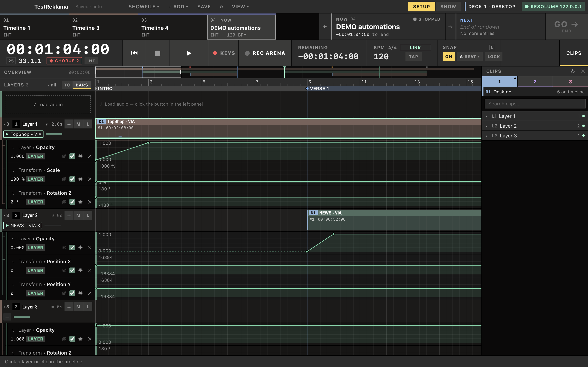
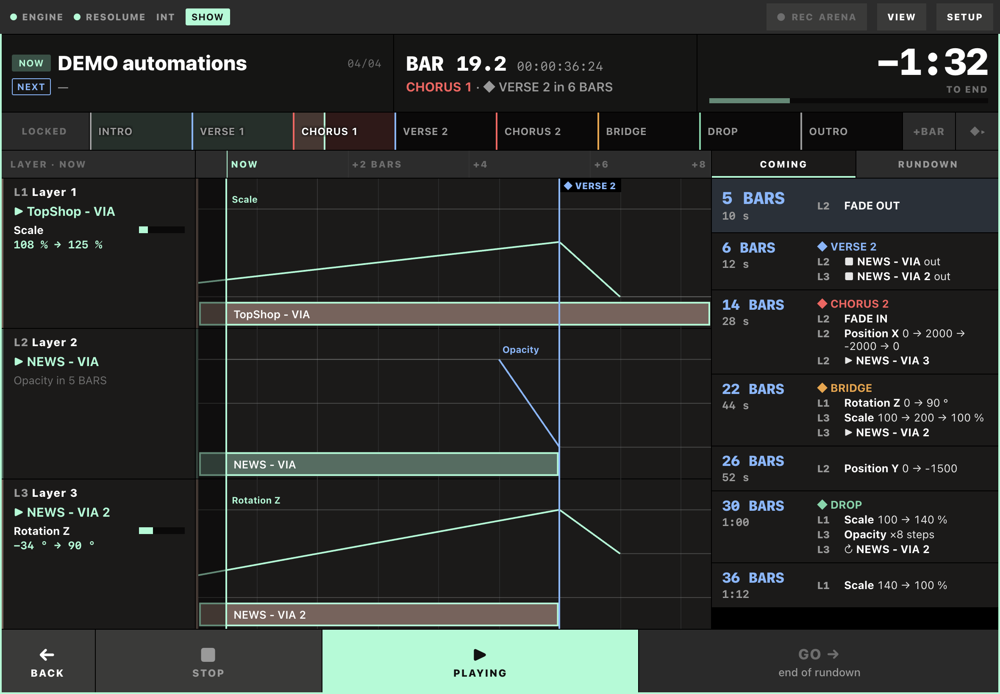
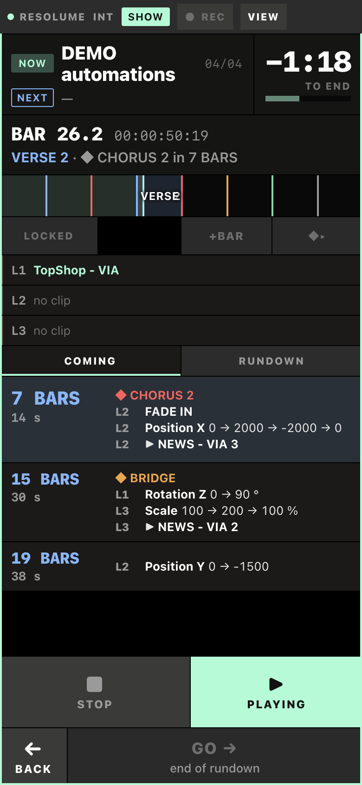

# Resolume Timeline

A timeline and cue sequencer for **Resolume Arena 7**, for live shows. It runs on the same Mac as
Resolume. You place clips on layers, draw automation for any Resolume parameter (opacity, effects,
transforms, groups) and play it all against an internal clock or incoming **LTC timecode**.
Several timelines (songs) sit in one showfile and are stepped through with **GO**.

It controls Resolume over OSC (port 7000), plus the REST API and WebSocket (port 8080).
Automation reaches Resolume at about 60 values a second while playing, so fades and moves look as
smooth as they draw. Tablets and phones on the same network can follow and run the show in a browser.



## Views

### Editor (SETUP)

The timeline, edited like Ableton Live's Arrangement View.

- **Rundown strip (top):** the timelines and breaks of the showfile, with *Now → Next* and **GO →**.
  - `Showfile ▾`: new, open, save, autosave, export.
  - `+ Add ▾`: a new timeline, an imported timeline, or a break.
  - `View ▾`: the look of SHOW mode on this device, the mini window, touch mode and scale.
  - `⚙`: the timeline's clock, LTC inputs, audio output and Resolume address.
- **Layers and clips:** mirror the Resolume composition (layers, groups, decks).
  - Drag clips in from the clip browser.
  - Trim, split, duplicate, copy and paste them.
  - A clip follows the playhead: stop pauses it, scrubbing moves it.
- **Automation lanes:** one lane per Resolume parameter. Curves include linear, hold, ease and Resolume's curve families, and a segment can be bent with Option-drag. Lanes can also be recorded live from Resolume.
- **Time selection and material:** select a span across rows, then cut, copy, paste, duplicate or delete the time. Snap to the bar grid or to timecode.
- **Markers:** right-click the ruler and choose *Add marker*.
  - Name a marker, or give it a song part (INTRO, VERSE, CHORUS…), and a colour.
  - The markers are the song's sections everywhere in the app.
  - Drag a marker to move it; click it to jump there.
- **Tempo:** BPM, the bar grid and bar 1. The tempo can be linked to Resolume's tempo.
- **Inspector (bottom):** the selected cue, layer or clip, with its live values and ▶ Fire.


### SHOW mode: Desktop style

The editor's top bar and a show bar (transport, bar, time left, BPM, REC). Under them is a minimal
picture of the show:
- the section strip;
- what each layer plays now;
- a radar of the next bars with every automation move;
- the coming events.

Timeline edits are locked. Stop and switching timelines need a second press while it plays.


### SHOW mode: Tablet style

The show view, readable from two metres: the clock, the section strip, the radar, the coming events and big **BACK · STOP · PLAY · GO** buttons.
- Open it on any tablet with the link and QR code from the top bar's **Tablet** button.
- `VIEW` sets its size (Compact, Normal or Large) and its scale.

A **phone** always gets a compact version of this view.





### Mini window

For one laptop without a tablet: a bar that floats over a full-screen Resolume, docked to an edge of the screen.
- It shows Now / Next, the bar and section with a progress bar for the section, the time to the end and the next events.
- Its buttons: ⏮ · STOP · PLAY · ← · GO →.
- It can be a strip (top or bottom edge) or a column (left or right edge); drag its edge to set the thickness.
- Turn it on with View ▾ › Mini window, or with **View › Mini Window (⇧⌘M)**.


## Build

Requirements:
- macOS on Apple silicon
- Node.js 20 or newer
- Resolume Arena 7 on the same Mac

```bash
npm install
npm run dist        # → dist/mac-arm64/Resolume Timeline.app (and a .dmg / .zip)
```

The app is signed ad hoc. On another Mac, open it the first time with right-click › Open.

Development:

```bash
npm run dev         # the Electron app with hot reload
npm run web         # the same engine in the Vite dev server, UI at http://127.0.0.1:5174
npx tsc --noEmit -p tsconfig.web.json && npx tsc --noEmit -p tsconfig.node.json   # typecheck
npm run test:ltc    # LTC decoder test
```

Run only one engine at a time (the app or `npm run web`): both would send to Resolume.

## Use

1. **Set up Resolume:**
   - Preferences › Webserver: enable it (port 8080).
   - Preferences › OSC: enable OSC input (port 7000).
2. **Start Resolume Timeline.** The status chip turns green when it reaches Resolume, and the layers of the composition appear as rows.
3. **Add clips and automation:**
   - `Clips` opens the clip browser. Drag clips onto their layers.
   - Add lanes from a layer's header and draw keys (double-click a lane).
4. **Set the clock:** in ⚙, choose *Internal* or an *LTC* input (SMPTE A or B, with the timeline's start timecode). An LTC timeline plays when its timecode arrives.
5. **Build the rundown:** add a timeline per song (`+ Add`) and breaks, and set the BPM and markers.
6. **Showtime:**
   - Switch to **SHOW** (top bar).
   - Press **Space** to play or stop.
   - Press **Enter** or **GO →** to load the next timeline (while playing, press it twice).
   - On a tablet, turn on **Tablet** and open the link it shows.

Saving: the showfile (`~/Documents/Resolume Timeline/*.rtshow`) autosaves. The open session also
survives a crash or restart (`~/Library/Application Support/Resolume Timeline/session.json`).
